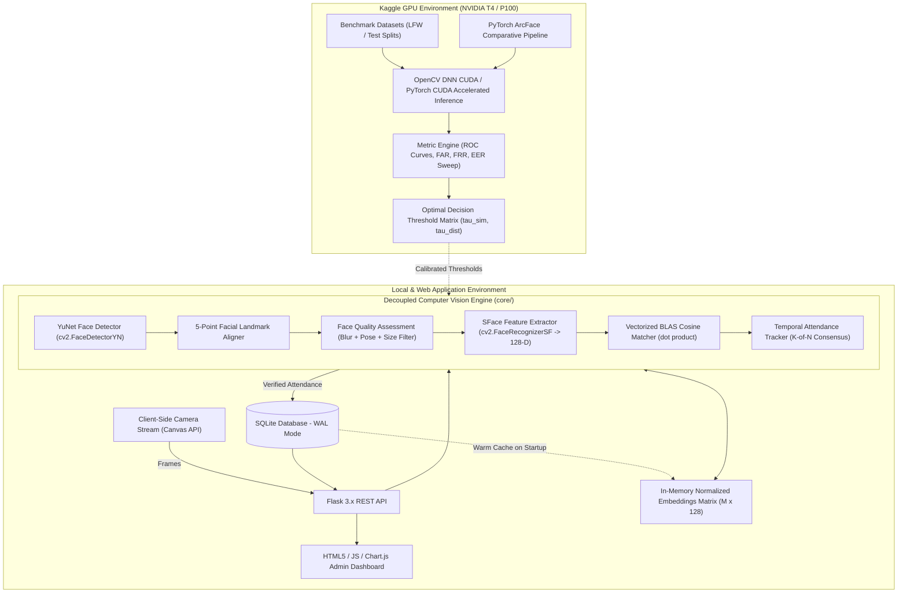
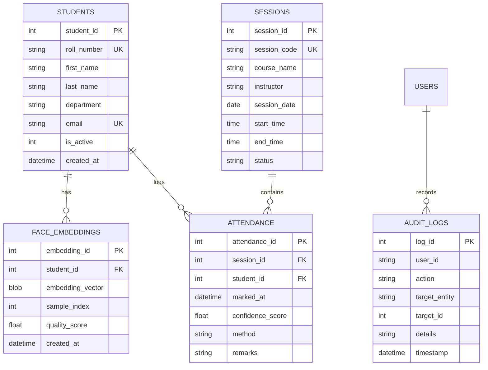

# FaceAttend AI: Technical Architecture & System Blueprint

## 1. Executive Summary & Project Mission

**FaceAttend AI** is an AI-powered, academic-grade Computer Vision and Attendance Management System. It replaces traditional manual or card-based attendance logging with automated face detection, landmark alignment, deep facial feature extraction, and high-speed vector matching.

The system is architected with a strict separation of concerns:
- **Core CV Engine (`core/`)**: Completely headless and decoupled from web frameworks, enabling identical execution in local scripts, Flask APIs, and GPU-accelerated Kaggle notebooks.
- **Kaggle GPU Engine (`notebooks/`)**: High-throughput batch inference, ROC/DET curve evaluation, FAR/FRR threshold calibration, and PyTorch ArcFace comparative studies on NVIDIA T4/P100 GPUs.
- **Local Application (`app.py`, `database/`, `templates/`)**: Real-time dual camera ingestion (Local OpenCV + Browser HTML5 Canvas), SQLite persistence with Write-Ahead Logging (WAL), and a modern glassmorphism administrative dashboard.

---

## 2. High-Level Architecture Diagram



---

## 3. Kaggle GPU Acceleration & Research Workflow

Kaggle provides free access to high-performance NVIDIA GPUs (T4 x 2 or P100). We utilize this compute tier for heavy computational experiments, metric verification, and architectural comparisons:

### 3.1 Kaggle Tasks & Capabilities
1. **GPU-Accelerated Model Inference**:
   - Running OpenCV DNN with `cv2.dnn.DNN_BACKEND_CUDA` and `cv2.dnn.DNN_TARGET_CUDA` (or FP16) for batch inference across thousands of benchmark images.
   - High-throughput face detection and feature extraction without CPU bottlenecking.
2. **Academic Verification & Metric Generation**:
   - **False Acceptance Rate (FAR)** and **False Rejection Rate (FRR)** curves.
   - **Receiver Operating Characteristic (ROC)** and **Detection Error Tradeoff (DET)** analysis.
   - **Equal Error Rate (EER)** calculation to mathematically validate the optimal cosine similarity threshold ($\tau_{\text{sim}} \approx 0.637$).
3. **Advanced Research Extension (ArcFace vs. SFace)**:
   - Comparing lightweight SFace (128-D ONNX, mobile/edge friendly) against heavy PyTorch ResNet-50 ArcFace (512-D) on the LFW (Labeled Faces in the Wild) dataset using Kaggle GPU.
   - Demonstrates academic rigor by proving *why* SFace was selected for the live production tier (speed vs. accuracy trade-off).

---

## 4. Computer Vision Pipeline Specification

### 4.1 Face Detection & Alignment (YuNet)
- Model: `face_detection_yunet_2023mar.onnx`
- Input: BGR Image resized to dynamic multiples of 32 (default $640 \times 640$).
- Output: 14 elements per detection:
  - Bounding Box: $[x, y, w, h]$
  - 5 Facial Landmarks: Right eye $(x_0, y_0)$, Left eye $(x_1, y_1)$, Nose tip $(x_2, y_2)$, Right mouth corner $(x_3, y_3)$, Left mouth corner $(x_4, y_4)$
  - Face Confidence Score: $s \in [0.0, 1.0]$

### 4.2 Face Quality Assessment (FQA)
Prior to saving embeddings during student enrollment:
- **Sharpness**: Laplacian variance $\sigma^2(\nabla^2 I) \ge 80.0$.
- **Resolution**: Face crop width $\ge 80\text{px}$, height $\ge 80\text{px}$.
- **Pose Angle**: Tilt angle $\theta = \arctan\left(\frac{y_{\text{leye}} - y_{\text{reye}}}{x_{\text{leye}} - x_{\text{reye}}}\right) \le 20^\circ$.

### 4.3 Feature Extraction (SFace)
- Model: `face_recognition_sface_2021dec.onnx`
- Alignment: Affine transformation mapping the 5 landmarks to canonical coordinates ($112 \times 112$).
- Output: 128-dimensional float32 feature embedding $\mathbf{f} \in \mathbb{R}^{128}$, normalized via $L_2$ norm:
  $$\mathbf{e} = \frac{\mathbf{f}}{\|\mathbf{f}\|_2}, \quad \|\mathbf{e}\|_2 = 1.0$$

### 4.4 In-Memory Vector Matcher
For $M$ stored embeddings across registered students:
- Stored as a contiguous NumPy matrix $\mathbf{E} \in \mathbb{R}^{M \times 128}$.
- Normalized query embedding $\mathbf{e}_q \in \mathbb{R}^{128}$.
- Batch dot product produces similarity scores in one BLAS call:
  $$\mathbf{s} = \mathbf{E} \cdot \mathbf{e}_q \in [-1.0, 1.0]^M$$
- Identification logic:
  $$\text{score}_{\max} = \max(\mathbf{s}), \quad \text{student}^* = \text{ID}[\arg\max(\mathbf{s})]$$
  $$\text{Result} = \begin{cases} \text{student}^* & \text{if } \text{score}_{\max} \ge \tau_{\text{sim}} \\ \text{"Unknown"} & \text{otherwise} \end{cases}$$

### 4.5 Temporal State Machine
- **Sliding Consensus Window**: Requires identification of student $k$ in $\ge 3$ out of 5 consecutive frames.
- **Session Cooldown**: Prevents duplicate attendance logging within the active session.

---

## 5. Database Schema (SQLite with WAL Mode)



---

## 6. Project Directory Structure

```text
FaceAttend-AI/
├── ARCHITECTURE.md                  # System architecture specification
├── README.md                        # Setup and operational instructions
├── config.py                        # Centralized configuration & thresholds
├── requirements.txt                 # Python dependencies
├── app.py                           # Flask application entry point
├── core/                            # Standalone Computer Vision Engine
│   ├── __init__.py
│   ├── detector.py                  # YuNet face detector wrapper
│   ├── recognizer.py                # SFace feature extractor & aligner
│   ├── quality.py                   # Face Quality Assessment (FQA)
│   ├── matcher.py                   # Vectorized in-memory cosine matcher
│   └── attendance_engine.py         # Multi-face temporal tracker & consensus
├── database/                        # Persistence Layer
│   ├── __init__.py
│   ├── db.py                        # SQLite connection & CRUD operations
│   └── schema.sql                   # Relational schema definition with constraints
├── routes/                          # Flask Blueprints
│   ├── __init__.py
│   ├── auth.py                      # Admin authentication
│   ├── students.py                  # Student registration & profile APIs
│   ├── attendance.py                # Live attendance stream & session APIs
│   └── dashboard.py                 # Analytics & reporting APIs
├── models/                          # Pretrained ONNX Models
│   ├── face_detection_yunet_2023mar.onnx
│   └── face_recognition_sface_2021dec.onnx
├── static/                          # Frontend Assets
│   ├── css/style.css                # Modern executive styling
│   └── js/
│       ├── camera.js                # Canvas / WebRTC video capture
│       ├── attendance.js            # Live dashboard & event toasts
│       └── charts.js                # Chart.js analytics visualizations
├── templates/                       # HTML5 Jinja2 Templates
│   ├── base.html
│   ├── login.html
│   ├── dashboard.html
│   ├── students.html
│   ├── register.html
│   ├── live.html
│   ├── records.html
│   └── settings.html
├── notebooks/                       # Kaggle GPU Experimentation Suite
│   ├── 01_gpu_model_benchmark.ipynb # Latency & batch throughput on Kaggle GPU
│   ├── 02_roc_far_frr_evaluation.ipynb # Threshold calibration & ROC curves
│   └── 03_arcface_comparative_study.ipynb # PyTorch ArcFace vs. SFace analysis
├── scripts/
│   └── download_models.py           # Automated model downloader
└── tests/
    ├── test_core_cv.py              # Standalone CV engine unit tests
    └── test_database.py             # Database CRUD unit tests
```

---

## 7. Phased Implementation Roadmap

1. **Phase 1: Project Setup & Core CV Engine**
   - Model download automation, YuNet wrapper, SFace wrapper, test verification.
2. **Phase 2: Database Layer & In-Memory Vector Cache**
   - SQLite schema initialization, binary embedding storage, matrix dot-product matcher.
3. **Phase 3: Face Registration & Quality Control**
   - Laplacian blur filter, pose check, multi-sample enrollment pipeline.
4. **Phase 4: Live Attendance Engine & Temporal Smoothing**
   - Multi-face tracking, sliding window consensus, session cooldown logic.
5. **Phase 5: Flask REST API Backend**
   - Modular blueprints, JSON REST endpoints, live frame processing endpoint.
6. **Phase 6: Modern Web Dashboard & Real-Time Canvas UI**
   - Responsive UI, live video overlay, dynamic attendance toasts, student tables.
7. **Phase 7: Analytics, Reports & Audit Logging**
   - Chart.js dashboards, date/department filters, CSV export, audit trails.
8. **Phase 8: Kaggle GPU Notebooks & Academic Evaluation**
   - ROC/DET curves, FAR/FRR metrics, PyTorch ArcFace benchmark, academic paper/report draft.

