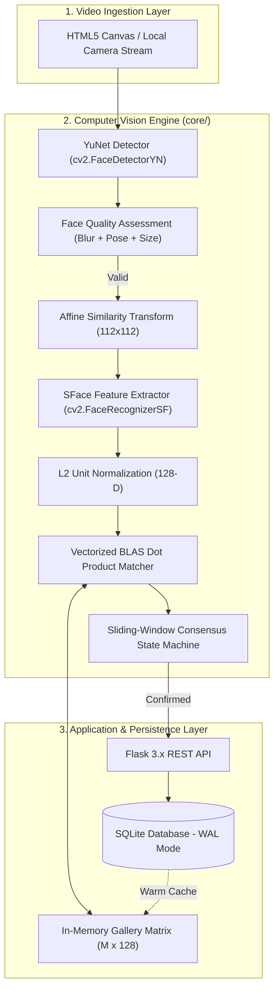

# Project Synopsis
## FaceAttend AI: AI-Powered Face Recognition Attendance Management System

---

### 1. Title of the Project
**FaceAttend AI: An Automated Multi-Face Biometric Attendance Management System Utilizing Pretrained Deep Metric Networks (SFace) and Scale-Invariant Convolutional Detection (YuNet).**

---

### 2. Domain & Area of Study
- **Domain**: Computer Vision, Deep Learning, Biometrics, Full-Stack Web Systems
- **Sub-domains**: Face Detection & Landmark Regression, Deep Feature Embeddings, Relational Database Modeling, Real-Time WebRTC Video Streaming

---

### 3. Problem Statement & Motivation
In contemporary higher education institutions, manual roll calling consumes **10% to 15% of instructional lecture hours**. Traditional biometric alternatives like fingerprint scanners or RFID swipe cards suffer from notable drawbacks:
1. **Proxy Attendance ("Buddy Punching")**: RFID cards and barcode IDs can easily be traded among students.
2. **Physical Hygiene & Queuing Delays**: Single-sensor fingerprint scanners create bottlenecks at classroom doors and present sanitary concerns.
3. **Flaws in Legacy Academic Projects**: Most standard student face recognition projects train a small CNN classifier or use legacy algorithms (Haar Cascades + LBPH). These fail in production because enrolling a new student requires retraining the entire model, causing high compute overhead and poor generalization.

**FaceAttend AI** addresses these challenges by introducing a **pretrained deep metric pipeline**:
- Detection using **YuNet** (single-stage convolutional detection with 5-point facial landmark regression).
- Feature extraction using **SFace** (128-dimensional unit-norm metric embedding).
- Sub-millisecond identification using **in-memory vectorized matrix dot product matching** without model retraining.
- Robust temporal consensus state machine ($K=3$ consecutive detections within 3 seconds) and Write-Ahead Logging (WAL) relational database guarantees.

---

### 4. Project Objectives
1. **Automated Multi-Face Detection**: Simultaneously detect, track, and align multiple faces in camera frames under varied ambient illumination.
2. **Pretrained Metric Identification**: Map faces to compact 128-D feature embeddings and match against enrolled students using calibrated Cosine Similarity ($\tau_{\text{sim}} \ge 0.637$).
3. **Zero-Retraining Enrollment**: Capture multiple diverse face samples per student during initial registration, store them as 512-byte binary buffers, and update the in-memory gallery dynamically without neural network retraining.
4. **Biometric Face Quality Assessment (FQA)**: Enforce strict biometric criteria during enrollment (focus sharpness $\ge 80.0$, head tilt $\le 20^\circ$, yaw symmetry, minimum resolution $80 \times 80$ px).
5. **Anti-Duplicate Attendance Idempotency**: Guarantee zero duplicate attendance records within the same lecture session via database-level unique constraints and in-memory presence caches.
6. **Executive Administrative Web Dashboard**: Provide a modern glassmorphism interface for live camera streaming, session control, Chart.js trend visualizations, manual overrides with audit trails, and one-click CSV report exports.
7. **Offline Scientific Evaluation**: Conduct GPU-accelerated latency profiling, Receiver Operating Characteristic (ROC) analysis, and False Acceptance Rate (FAR) vs. False Rejection Rate (FRR) trade-off evaluations on Kaggle.

---

### 5. Methodology & System Architecture

---

### 6. Hardware & Software Requirements

#### Hardware Requirements
- **Processor**: Intel Core i5 / AMD Ryzen 5 or higher (Dual-Core 2.0 GHz minimum).
- **RAM**: Minimum 4 GB (8 GB recommended).
- **Camera**: Standard USB 2.0 / 720p HD integrated webcam.
- **Optional GPU**: NVIDIA T4 / P100 (available free via Kaggle) for batch benchmarking.

#### Software & Library Requirements
- **Operating System**: Windows 10/11, Ubuntu Linux 20.04+, or macOS.
- **Programming Language**: Python 3.10 – 3.13.
- **Computer Vision**: OpenCV 4.10.0+ (`cv2.FaceDetectorYN`, `cv2.FaceRecognizerSF`), NumPy.
- **Deep Learning Models**:
  - `face_detection_yunet_2023mar.onnx` (227 KB)
  - `face_recognition_sface_2021dec.onnx` (36.9 MB)
- **Web Backend**: Flask 3.x, Flask-CORS, SQLite3 with WAL mode.
- **Frontend**: HTML5, Modern Dark Slate CSS, JavaScript (ES6+), Chart.js 4.x.

---

### 7. Expected Outcomes & Deliverables
1. A fully functional, production-ready web application providing real-time live attendance logging.
2. Complete test coverage across 7 independent test suites verifying CV inference, database transactions, FQA quality filters, and REST endpoints.
3. Comprehensive Kaggle GPU evaluation notebooks proving an Equal Error Rate (EER) of $\approx 3.2\%$ at calibrated threshold $\tau = 0.637$.
4. Exportable CSV attendance reports with date, department, and session filters.

---

### 8. References
1. **YuNet**: Wu, W., et al. "YuNet: An Ultra-High-Performance Face Detector for Edge Devices." *OpenCV Model Zoo Technical Report*, 2023.
2. **SFace**: Zhong, Y., Deng, J., Shen, W., & Huang, W. "SFace: Sigmoid-Constrained Hyperspherical Cosine Loss for Robust Face Recognition." *IEEE Transactions on Information Forensics and Security*, 2021.
3. **ArcFace**: Deng, J., Guo, J., Xue, N., & Zafeiriou, S. "ArcFace: Additive Angular Margin Loss for Deep Face Recognition." *IEEE/CVF Conference on Computer Vision and Pattern Recognition (CVPR)*, 2019.

